### AI & Technology Enthusiast | Aspiring Developer

*Learning, building, and growing one project at a time.*

---

## 👨‍💻 About Me

- 🌱 Learning programming and software development.
- 💻 Exploring HTML, CSS, JavaScript, Python, and Java.
- 🛠️ Using Git, GitHub, and VS Code for development.
- 🚀 Building projects to strengthen my technical skills.

## 🧰 Technologies

  

## 📊 GitHub Contributions

<h2 align="center">📊 GitHub Contributions</h2>

  

## 🤝 Connect

  

*BUILD • LEARN • CREATE*

